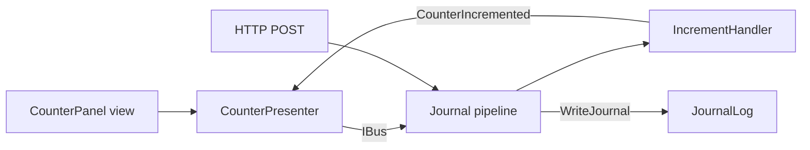
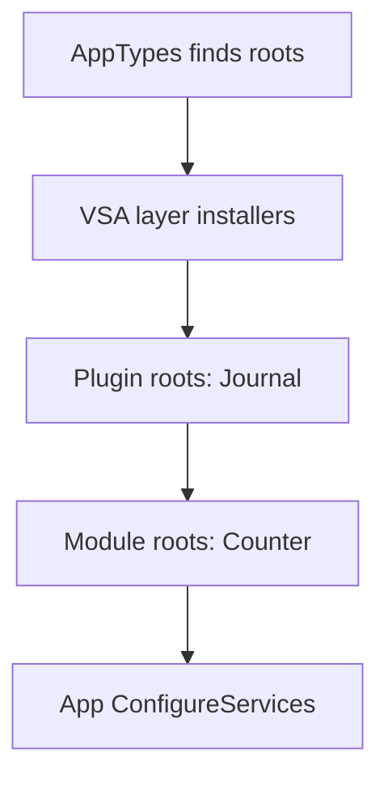

# vsa-consumer-dotnet

A .NET app that uses the published Umpire packages from [vsa-template](https://github.com/MgCohen/vsa-template), with the VSA pack. It has one feature module (`Counter`) and one plugin module (`Journal`). CI restores, builds, checks and tests the app with the packages from GitHub Packages, so it is also the release check of Umpire for .NET.

## What the app shows



| Part | File | Shows |
|---|---|---|
| App class | `App/Host/ConsumerApp.cs` | The pack and the web host |
| Module root | `Features/Counter/CounterModule.cs` | Settings, services, repository |
| Plugin root | `Plugins/Journal/JournalPlugin.cs` | Settings, a custom pipeline |
| Validator | `Slices/Increment/IncrementValidator.cs` | A check before the handler |
| Command | `Slices/Reset/` | A message for other modules |
| Presenter | `Presenters/CounterPresenter.cs` | Requests down, events up |
| Tests | `Tests/` | Unit, composition and architecture tests |

## Start a project

1. Set the token for GitHub Packages:
   ```bash
   export GITHUB_TOKEN=$(gh auth token)
   ```
2. Make the app. The folder must have a `nuget.config` with the Umpire feed, for example the one of this repo:
   ```bash
   dotnet tool exec Umpire.Cli@0.1.0 -y -- new app Consumer
   ```
3. Add the code:
   ```bash
   cd Consumer
   dotnet umpire add module Counter
   dotnet umpire add request Increment -m Counter
   dotnet umpire add request GetCount -m Counter
   dotnet umpire add command Reset -m Counter
   dotnet umpire add plugin Journal
   ```
4. Run the tests and the app:
   ```bash
   dotnet test --solution Consumer.slnx
   dotnet run --project Consumer.csproj
   ```

The tool writes only new files. The code in the slices, the roots and `Tests/` is custom code on top of them.

## Use Umpire as a dependency

The app gets Umpire from NuGet packages only. It has no copy of the framework source.

| File | Umpire item |
|---|---|
| `global.json` | `Umpire.Sdk` version (`msbuild-sdks`) |
| `dotnet-tools.json` | `umpire.cli` version |
| `Consumer.csproj` | `Umpire.Sdk`, `Umpire.Vsa.Hosts.Web`, `Umpire.Vsa.Views`, `Umpire.Engine.Build` |
| `Tests/App.Tests.csproj` | `Umpire.Vsa.Testing.Unit` |
| `Directory.Build.props` | All build output in `artifacts~/` |
| `nuget.config` | The GitHub Packages feed, token from `GITHUB_TOKEN` |

`Consumer.csproj` is the one root project. It compiles each file in `App/`, `Features/` and `Plugins/`. A module, a slice or a plugin module needs no project.

GitHub Packages needs a token, also for public packages:

| Where | Token |
|---|---|
| GitHub Actions | `GITHUB_TOKEN` of the workflow |
| Dev machine | `gh auth token`, after `gh auth refresh -s read:packages` |

## Composition root

The app class selects the pack and the host:

```csharp
public class ConsumerApp : App<Vsa<WebVsaHost>>;
```

`Program.cs` runs it: `return new ConsumerApp().Run(args);`. `Compose` configures the parts in this order:



### A module root

A module root inherits `Module` or `Module<TSettings>`. The host binds `Modules:<Name>` from the configuration, checks the data annotations, then calls `Configure`.

```csharp
public sealed class CounterModule : Module<CounterSettings> {
    public override void Configure(IServiceCollection services, CounterSettings settings) {
        services.AddSingleton(new TallyStore(Tally.Create(TallyId.Main, settings.Max)));
        services.AddScoped<IRepository<Tally, TallyId>, TallyRepository>();
    }
}
```

The root registers only what the host cannot find. The host finds the handlers, the validators and the presenters by their base types.

### A plugin root

A plugin module is in `Plugins/<Name>/` and its root inherits `Plugin` or `Plugin<TSettings>`. The host configures the plugin roots before the module roots.

```csharp
public sealed class JournalPlugin : Plugin<JournalSettings> {
    public override void Configure(IServiceCollection services, JournalSettings settings) {
        services.AddSingleton(new JournalLog(settings.MaxLines));
        services.AddPipeline(new PipelineBuilder<Journaled>()
            .HandlersOf(typeof(RequestHandler<,>))
            .AfterStep<WriteJournal>());
    }
}
```

A request that derives from `Journaled` goes through this pipeline. Other requests use the default pipeline.

### Settings

`appsettings.json` gives the settings of each root:

```json
"Modules": {
  "Counter": { "Max": 5 },
  "Journal": { "MaxLines": 50 }
}
```

If a value is not valid, the start stops with `Modules:Counter is not valid: ...`.

### Composition in a test

A test composes the same app with the generic host, with no ASP.NET Core:

```csharp
var services = new ServiceCollection().AddSingleton<IConfiguration>(configuration);
await using var app = new Vsa<VsaHost>().CreateHost().Compose(services, new ConsumerApp()).BuildServiceProvider();
```

See `Tests/CompositionTests.cs`.

## Architecture check

Each build of `Consumer.csproj` runs the rule engine. An error fails the build.

`umpire-baseline.txt` holds the errors that the build accepts. Each entry is a rule that fires on code that the Umpire docs allow:

| Code | Files | Reason |
|---|---|---|
| `UMP020101` | `IncrementValidator.cs` | The VSA pack has no part for a validator in a slice |
| `UMP020201` | `Plugins/Journal/**` | The pack has no part for a request base or a pipeline step |

If a fix in Umpire makes an entry stale, the engine gives `UMP030501`. Then run `dotnet build Consumer.csproj -p:UmpireUpdateBaseline=true`.

## Update Umpire

1. Run `dotnet umpire update`. It changes the tool manifest, `global.json` and the project files.
2. Run `dotnet umpire doctor`. It shows each version that is different.
3. Run the build and the tests. If the release is new, use `dotnet restore --no-http-cache` one time.
