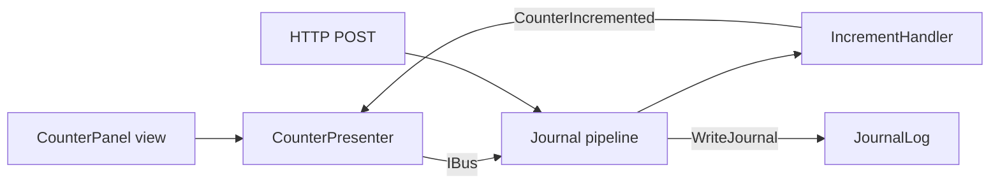
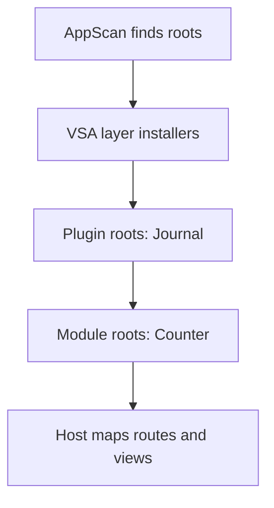

# vsa-consumer-dotnet

A .NET app that uses the published VSA packages from [vsa-template](https://github.com/MgCohen/vsa-template). It has one module (`Counter`) and one plugin module (`Journal`). CI restores, builds and tests the app with the packages from GitHub Packages, so it is also the release check of VSA for .NET.

## What the app shows



| Part | File | Shows |
|---|---|---|
| Host | `App/Host/Program.cs` | The one start line |
| Module root | `Modules/Counter/CounterModule.cs` | Settings, services, repository |
| Plugin root | `Plugins/Journal/JournalPlugin.cs` | Settings, a custom pipeline |
| Validator | `Slices/Increment/IncrementValidator.cs` | A check before the handler |
| Command | `Slices/Reset/` | A message for other modules |
| Presenter | `Presenters/CounterPresenter.cs` | Requests down, events up |
| Tests | `Tests/` | Unit tests and composition tests |

## Start a project

1. Set the token for GitHub Packages:
   ```bash
   export GITHUB_TOKEN=$(gh auth token)
   ```
2. Make the app:
   ```bash
   dotnet tool exec VSA.Cli@0.1.0-preview.9 -- new app Consumer
   ```
3. Add the code:
   ```bash
   cd Consumer
   dotnet tool restore
   dotnet vsa add module Counter
   dotnet vsa add request Increment -m Counter
   dotnet vsa add request GetCount -m Counter
   dotnet vsa add command Reset -m Counter
   dotnet vsa add plugin Journal
   ```
4. Run the tests and the app:
   ```bash
   dotnet test --solution Consumer.slnx
   dotnet run --project App/Host
   ```

The tool writes only new files. These commands made the files of this repo. The code in the slices, the roots and `Tests/` is custom code on top of them.

## Use VSA as a dependency

The app gets VSA from NuGet packages only. It has no copy of the framework source.

| File | VSA item |
|---|---|
| `global.json` | `VSA.Sdk` version (`msbuild-sdks`) |
| `dotnet-tools.json` | `vsa.cli` version |
| Each module or plugin `.csproj` | `<Project Sdk="VSA.Sdk" />` |
| `App/Host/App.Host.csproj` | `VSA.Host` |
| `App/Views/App.Views.csproj` | `VSA.Views` |
| `Tests/App.Tests.csproj` | `VSA.Testing.Architecture`, `VSA.Testing.Unit` |
| `nuget.config` | The GitHub Packages feed, token from `GITHUB_TOKEN` |

VSA.Sdk gives each module project its files and its references. Do not add references or `Compile` items to a module project.

GitHub Packages needs a token, also for public packages:

| Where | Token |
|---|---|
| GitHub Actions | `GITHUB_TOKEN` of the workflow |
| Dev machine | `gh auth token`, after `gh auth refresh -s read:packages` |

## Composition root

The host has one line. It finds the modules and the views by itself.

```csharp
await VsaBuilder.Create(args).UseWebHost().Build().RunAsync();
```

`Build()` configures the parts in this order:



### A module root

A module root inherits `Module` or `Module<TSettings>`. The host binds `Modules:<Name>` from the configuration, checks the data annotations, then calls `Configure`.

```csharp
public sealed class CounterModule : Module<CounterSettings> {
    public override void Configure(ModuleBuilder module, CounterSettings settings) {
        module.Services.AddSingleton(new TallyStore(Tally.Create(TallyId.Main, settings.Max)));
        module.Services.AddScoped<IRepository<Tally, TallyId>, TallyRepository>();
    }
}
```

The root registers only what the host cannot find. The host finds the handlers, the validators, the Before and After events and the presenters by their base types.

### A plugin root

A plugin module is in `Plugins/<Name>/` and its root inherits `Plugin` or `Plugin<TSettings>`. Each layer of each module gets the same layer of the plugin module. The host configures the plugin roots before the module roots.

```csharp
public sealed class JournalPlugin : Plugin<JournalSettings> {
    public override void Configure(ModuleBuilder module, JournalSettings settings) {
        module.Services.AddSingleton(new JournalLog(settings.MaxLines));
        module.Services.AddPipeline(new PipelineBuilder<Journaled>()
            .HandlersOf(typeof(RequestHandler<,>))
            .AfterStep<WriteJournal>());
    }
}
```

A request of a module that derives from `Journaled` goes through this pipeline. Other requests use the default pipeline.

```csharp
public sealed record IncrementRequest(int Amount) : Journaled, IRequest<IncrementResponse> { ... }
```

### Settings

`App/Host/appsettings.json` gives the settings of each root:

```json
"Modules": {
  "Counter": { "Max": 5 },
  "Journal": { "MaxLines": 50 }
}
```

If a value is not valid, the start stops with `Modules:Counter is not valid: ...`.

### Composition in a test

A test starts the same app with the generic host, with no ASP.NET Core:

```csharp
using var app = VsaBuilder.Create("--Modules:Counter:Max=3").UseGenericHost().Build();
await using var scope = app.Services.CreateAsyncScope();
await scope.ServiceProvider.GetRequiredService<IBus>().Send(new IncrementRequest(2));
```

See `Tests/CompositionTests.cs`.

## Update VSA

1. Set the new version in `global.json`, `dotnet-tools.json`, `App/Host/App.Host.csproj`, `App/Views/App.Views.csproj` and `Tests/App.Tests.csproj`.
2. Run `dotnet vsa doctor`. It shows each version that is different.
3. Run the tests. If the release is new, use `dotnet restore --no-http-cache` one time.
